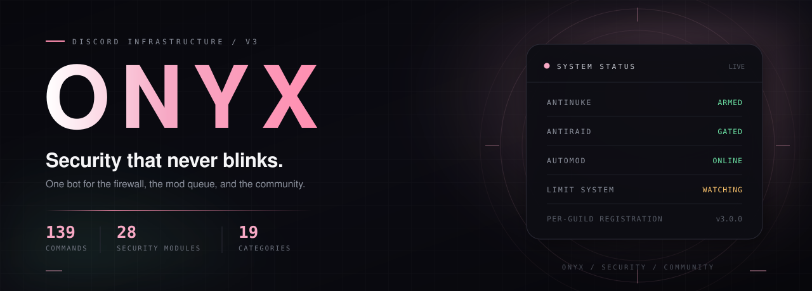
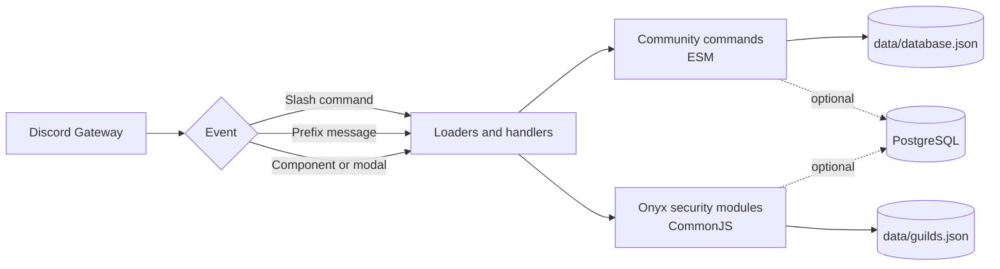

<div align="center">
  

  <br />
  <br />

  <a href="https://nodejs.org/"></a>
  <a href="https://discord.js.org/"></a>
  <a href="./LICENSE"></a>
  
  
  

  <h3>Security that never blinks.</h3>

  <p>
    A Discord bot for the firewall, the mod queue, and the community.<br />
    AntiNuke &middot; AntiRaid &middot; AntiBetray &middot; AutoMod &middot; tickets &middot; giveaways &middot; economy &middot; leveling
  </p>

  <p>
    <a href="#quick-setup">Quick start</a> &middot;
    <a href="#features">Features</a> &middot;
    <a href="#command-reference">Commands</a> &middot;
    <a href="#configuration">Configuration</a> &middot;
    <a href="#deployment">Deploy</a>
  </p>
</div>

---

> **The premise is simple.** Trust is a budget, not a badge. Every privileged action is checked, limited, logged, and reversible where possible.

**Onyx** is a self-hosted Discord bot built on **Node.js** and **discord.js v14**. It pairs a hardened security suite with the everyday work of running a server: moderation with receipts, tickets, giveaways, applications, onboarding, verification, logging, counters, economy, leveling, and a deep utility drawer.

Data lives in local JSON by default, so the bot runs with **no external services**. PostgreSQL is available when you outgrow a single file. Music is intentionally disabled in this build.

<br />

<table align="center">
<tr>
<td align="center" width="25%"><h3>140</h3><sub>commands</sub></td>
<td align="center" width="25%"><h3>28</h3><sub>security modules</sub></td>
<td align="center" width="25%"><h3>19</h3><sub>categories</sub></td>
<td align="center" width="25%"><h3>0</h3><sub>required external services</sub></td>
</tr>
</table>

---

<a name="features"></a>
## Why Onyx

### 01 — Security that assumes staff can go rogue

Most anti-nuke bots stop watching a user the moment they are whitelisted. Onyx keeps score. The **Limit System** gives trusted staff a budget of sensitive actions inside a rolling window. Exceed it and **Anti-Betray** overrides the whitelist, strips dangerous roles, quarantines the offender, and can lock the server down.

### 02 — Moderation that writes receipts

Every action returns a compact confirmation. No walls of fields, no decorative footers, no "Ack / Dismiss" buttons. Panels are reserved for data that needs to be read: case histories, warnings, security audits, and dashboards.

```text
!lock      🔒 #general locked for @everyone.
!unlock    🔓 #general unlocked for @everyone.
!ban       @user banned.
!kick      @user kicked.
!jail      🔒 @user jailed.
!unjail    🔓 @user released.
!purge     Deleted 42 messages in #general.
!snipe     @user · 12s ago
           the deleted message
!brainrot  add @user
           @user is now brainrot locked.
```

Role and nickname changes follow the same grammar, including grouped multi-role updates:

```text
@Staff, @Verified added to @user.
Nickname of @user set to `onyx`.
```

### 03 — Community systems that feel native

Tickets, giveaways, applications, birthdays, welcome flows, reaction roles, verification, logging, and live counters all share one visual language and one storage layer. Nothing feels bolted on.

---

## What's inside

<table>
<tr>
<td width="33%" valign="top">
<h3>🛡️ Security</h3>
<p>AntiNuke, AntiRaid, AntiBetray, AutoMod, limit thresholds, per-module whitelists, extra owners, Fortress permission freezing, media-only channels, lockdown, jail, and a security posture audit.</p>
<p><sub>28 modules · per-guild registration</sub></p>
</td>
<td width="33%" valign="top">
<h3>🧹 Moderation</h3>
<p>Ban, kick, softban, hardban, mass ban, mass kick, timeout, purge, warnings, cases, user notes, channel lock, snipe, brainrot lock, jail, nickname, role, DM, and channel nuke.</p>
<p><sub>18 commands · hierarchy checks before every action</sub></p>
</td>
<td width="33%" valign="top">
<h3>🎟️ Community</h3>
<p>Ticket panels with claim, priority, transcripts, and DM-on-close. Giveaways with rerolls. Role applications with review. Welcome, goodbye, autorole, birthdays, and counting.</p>
<p><sub>tickets · giveaways · applications · onboarding</sub></p>
</td>
</tr>
<tr>
<td width="33%" valign="top">
<h3>💰 Economy &amp; leveling</h3>
<p>Wallet and bank, daily rewards, work, crime, robbery, fishing, mining, gambling, shop, inventory, transfers, and leaderboards. XP, rank cards, role rewards, milestones, and admin level controls.</p>
<p><sub>19 economy commands · 6 leveling commands</sub></p>
</td>
<td width="33%" valign="top">
<h3>⚙️ Automation</h3>
<p>Event logging with per-category destinations. Live member, human, and bot counters. Button verification with account-age rules. Reaction role panels. Join-to-Create temporary voice channels.</p>
<p><sub>logging · counters · verification · reaction roles · JTC</sub></p>
</td>
<td width="33%" valign="top">
<h3>🧰 Utility &amp; fun</h3>
<p>Polls, calculators, timestamps, password and color generation, URL shortening, dictionaries, web search, weather, todo lists, reports, user/server info, anime actions, and social meters.</p>
<p><sub>11 tools · 9 utilities · 18 fun commands</sub></p>
</td>
</tr>
</table>

---

## The security suite

Onyx treats server security as layered infrastructure rather than a single "anti-nuke" switch.

| Layer | What it does |
| --- | --- |
| **AntiNuke** | Watches destructive actions: bans, kicks, bot adds, channel and role changes, member role updates, `@everyone` mentions, guild/vanity edits, integrations, webhooks, and prunes. Auto-recovery restores what it can. |
| **AntiRaid** | Gates mass joins with join-rate thresholds and account-age requirements, then applies the configured action. |
| **AntiBetray** | Keeps whitelisted staff inside the limit system. A breach strips dangerous roles, quarantines the offender, and can trigger lockdown. |
| **Limit System** | Per-action thresholds inside a configurable rolling window, with live usage tracking and one-command resets. |
| **AutoMod** | Nine filters — spam, caps, links, invites, mass mentions, emoji spam, NSFW links, external apps, and token spam — plus a custom word blacklist. |
| **Whitelist &amp; owners** | Trust members per module, manage extra owners, and keep configuration authority separate from day-to-day moderation. |
| **Fortress** | Freezes dangerous role permissions during a raid or high-risk window. |
| **Jail** | Creates a `Jailed` role, a private `#jail` containment channel, and a staff-only `#jail-logs` audit channel; strips roles on entry, restores them on release, and keeps jail notices out of the normal audit log. `!jail reset` releases jailed members and removes containment while preserving the jail log history. |
| **Media channels** | Restricts selected channels to images, video, attachments, and media links. |
| **Lockdown** | Locks every public text channel for `@everyone` in one command, and restores them in one command. |
| **Security audit** | Scores the server's posture and returns concrete recommendations. |

> **Field note.** For full containment, the bot's highest role must sit above the roles it manages. Many deployments grant Administrator so a rogue admin can be contained; the security suite is designed around that assumption.

> **Custom emoji.** The server owner can connect a dedicated emoji server with `!cx add <server id>` — the bot must already be a member, since Discord does not let bots join a server by ID. One `!cx add` syncs its emojis into `data/emojiConfig.json` and auto-maps `Blue_Plus_Icon` → `roleAdd`, `Blue_Minus_Icon` → `roleRemove`, `Glossy_Green_Icon` → `tick`, and `Glossy_Red_Icon` → `cross`, so no manual setup is needed. Role give/take replies and audit logs use the role markers (falling back to ➕/➖), while moderation receipts use `tick`/`cross` (falling back to ✅/❌). `!cx set <slot> <emoji>` overrides any slot, `!cx sync` refreshes emojis without touching your overrides, and `!cx list` / `!cx clear` manage the connection.

### Security setup path

```text
/setup                  # interactive security acceptance + infrastructure
/antinuke enable        # create the role matrix and arm AntiNuke
/antiraid enable        # mass-join and account-age gates
/automod enable         # content filters
/limits status          # review staff action budgets
/whitelist add          # trust staff per module
!jail setup             # create the jail role + #jail and #jail-logs
/security               # audit the result
```

`!jail setup` and `!jail reset` are prefix-only. Everything else is available as a slash command. Prefix access covers the full community set and every Onyx module except the slash-only commands `configwizard`, `embedbuilder`, `wipedata`, and `apply`, plus dashboard and most guided-setup subcommands and the `setchannel` subcommands of `birthday` and `report`.

---

## Community systems

### 🎟️ Tickets
A persistent panel opens private tickets with a category, staff role, max tickets per user, and DM-on-close setting. Staff can claim and unclaim, set priority (`none`, `low`, `medium`, `high`, `urgent`), close with a reason, and archive to a closed category. A transcript channel and dashboard are configurable.

### 🎉 Giveaways
Host giveaways from 5 minutes to 30 days with 1–10 winners. End early, delete an entry, or reroll winners. Entry uses buttons; ended giveaways announce winners in-channel.

### 📝 Applications
Members apply for roles through a guided flow. Staff review approve or deny from a dashboard, with manager roles, submission cooldowns, pending-application limits, and automatic cleanup windows.

### 👋 Onboarding
Welcome and goodbye messages support `{user}`, `{username}`, `{server}`, and `{memberCount}` placeholders, optional images, and member pings. Autorole assigns roles on join.

### ✅ Verification
Post a verification panel with a custom message and button label. Verified members receive a role. Auto-verify can approve everyone or require a minimum account age. Cooldowns, attempt limits, DM notifications, and an audit trail are built in.

### 🎭 Reaction roles
Publish a select-menu panel with up to five roles, a title, and a description. Members assign and remove their own roles without staff involvement.

### 🎂 Birthdays
Members set a birthday once, view upcoming birthdays, and receive announcements. Configure the announcement channel, birthday role, and timezone.

### 📈 Logging &amp; counters
Route every event category to its destination: moderation, messages, channels, roles, members, leveling, reaction roles, giveaways, counters, applications, reports, and jail, with separate audit, application, report, and jail channels. Deleted images and videos are re-uploaded so the exact media is previewed in the log instead of a bare `#attachment` count. Jail actions stay in `#jail-logs` and never mix with the normal audit log. Live voice-channel counters track total members, humans, and bots.

### 🔌 Join to Create
A trigger voice channel spawns a temporary channel for each member. Owners can rename, lock, unlock, set a limit, claim an abandoned channel, transfer ownership, or delete it. An optional Interface panel exposes the same controls as buttons.

### 🔢 Counting
A channel-scoped counting game with streak tracking, reset controls, and a leaderboard.

---

## Economy &amp; leveling

**Economy.** Wallet and bank balances, daily rewards, work, begging, crime (failed attempts can land you in jail), robbery, fishing, mining, gambling, a configurable shop, inventory, transfers, deposits, withdrawals, and a richest-members leaderboard. Shop configuration can grant a Discord role for the Premium Role item.

**Leveling.** XP per message (default 15–25), a per-user cooldown (default 20 seconds), rank cards, a server leaderboard, level-up announcements, role rewards, and milestone hooks. Staff can add, remove, or set levels directly.

---

<a name="command-reference"></a>
## Command reference

**140 commands** ship in this build: **112 community commands** plus **28 Onyx security modules**, across **19 categories**.

| Surface | Behavior |
| --- | --- |
| **Prefix** | `!command` by default. Most community commands and every Onyx module answer to the prefix. `configwizard`, `embedbuilder`, `wipedata`, and `apply` are slash-only, as are dashboards and guided setup flows. Change the prefix per server with `!setprefix <prefix>`. |
| **Slash** | `/command`. Community commands register globally within Discord's 100-command cap, so the loader registers up to the cap and the full set remains available through the prefix. The Onyx suite registers per guild, giving it its own budget and instant availability. |
| **Aliases** | Common shortcuts such as `bal`, `av`, `pfp`, `h`, `lb`, `inv`, `calc`, `ui`, `si`, `rr`, `jtc`, `bd`, `gstart`, and `gstop` resolve to their full commands. |
| **Slash-only flows** | Dashboards, most guided-setup subcommands, and the `birthday` / `report` `setchannel` subcommands. The jail setup/reset pair is prefix-only. |

**Jump to a category:**
[Core](#core) · [Onyx Security](#security) · [Moderation](#moderation) · [Economy](#economy) · [Leveling](#leveling) · [Community](#community) · [Fun](#fun) · [Giveaway](#giveaway) · [Ticket](#ticket) · [Welcome](#welcome) · [Reaction Roles](#reaction-roles) · [Verification](#verification) · [Birthday](#birthday) · [Logging](#logging) · [Server Stats](#server-stats) · [Join to Create](#join-to-create) · [Search](#search) · [Tools](#tools) · [Utility](#utility)

<a name="core"></a>
<details open>
<summary><b>ℹ️ Core</b> · 8 commands</summary>

*The control room.*

| Command | Description | Subcommands |
| --- | --- | --- |
| `commands` | Enable or disable commands and categories for this server | `dashboard`, `disable`, `enable` |
| `configwizard` | Open the guided server configuration wizard (slash-only) | — |
| `help` | Browse every available command with category menus and pagination | — |
| `ping` | Check gateway latency and API speed | — |
| `setprefix` | Change this server's command prefix (e.g. `!setprefix &`) | — |
| `stats` | View bot statistics and uptime | — |
| `support` | Get the support server invite | — |
| `uptime` | Check how long Onyx has been online | — |

</details>

<a name="security"></a>
<details>
<summary><b>🛡️ Onyx Security</b> · 28 modules</summary>

*Trust is a budget.*

| Command | Description | Subcommands |
| --- | --- | --- |
| `antinuke` | Arm AntiNuke and create its security role matrix | `enable`, `disable`, `status` |
| `antiraid` | Configure mass-join limits and account-age gates | `enable`, `disable`, `accountage`, `action`, `status` |
| `antibetray` | Override the whitelist when trusted entities go rogue | `status`, `enable`, `disable`, `lockdown` |
| `automod` | Configure nine content filters and a word blacklist | `enable`, `disable`, `status`, `blacklist` |
| `customrole` | Configure preset and named custom role commands | `create`, `delete`, `setup`, `list`, `reset` |
| `dehoist` | Reset hoisting nicknames that start with symbols | — |
| `extraowner` | Manage extra trusted owners for AntiNuke | `add`, `remove`, `list` |
| `fortress` | Freeze dangerous role permissions during a raid | `enable`, `disable`, `status` |
| `hardban` | Hardban a user and re-ban them if unbanned | — |
| `jail` | Isolate a member and manage the jail setup | `setup`, `reset` (prefix) |
| `limits` | Configure staff action thresholds and windows | `status`, `enable`, `disable`, `set`, `window`, `reset` |
| `lockdown` | Lock all public text channels for `@everyone` | — |
| `media` | Keep selected channels media-only | `add`, `remove`, `list` |
| `mute` | Time out a member for 5 minutes by default | — |
| `nickname` | Set or clear a member's nickname (`!nick @user [name]`) | — |
| `nuke` | Clone and delete the current channel to wipe messages | — |
| `role` | Add, remove, or toggle roles for a member (multiple roles supported) | — |
| `security` | Audit the server's security posture and score | — |
| `setup` | Start the interactive security acceptance flow | — |
| `softban` | Ban to purge 7 days of messages, then unban | — |
| `spamraid` | Post a click-to-send spam panel with Send and Burst controls | — |
| `unjail` | Release a member from jail and restore roles | — |
| `unlockdown` | Lift lockdown and restore send permissions | — |
| `unmute` | Remove a timeout from a member | — |
| `vc` | Join-to-Create voice system with an interface panel | `setup`, `panel`, `interface`, `rename`, `lock`, `unlock`, `limit`, `claim`, `transfer`, `delete` |
| `voice` | Create and manage voice channels with lock/hide controls | `create`, `panel` |
| `voicemod` | Voice moderation: kick, mute, deafen, and move | `kick`, `mute`, `unmute`, `deafen`, `undeafen`, `moveall` |
| `whitelist` | Manage per-module trusted users | `panel`, `add`, `remove`, `list` |

</details>

<a name="moderation"></a>
<details>
<summary><b>🧹 Moderation</b> · 18 commands</summary>

*Receipts, not essays.*

| Command | Description | Subcommands |
| --- | --- | --- |
| `ban` | Ban a user from the server | — |
| `brainrotlock` | Repost a user's messages as them with a random brainrot phrase | `add`, `remove` |
| `cases` | View moderation cases and filter the audit trail | — |
| `dm` | Send a direct message to a user as staff | — |
| `kick` | Kick a user from the server | — |
| `lock` | Lock the current channel for `@everyone` | — |
| `massban` | Ban multiple users at once | — |
| `masskick` | Kick multiple users at once | — |
| `purge` | Delete up to 500 messages (defaults to 20) | — |
| `say` | Send a plain message as the bot | — |
| `snipe` | Show the most recently deleted message in this channel | — |
| `timeout` | Time out a user for a duration | — |
| `unban` | Unban a user | — |
| `unlock` | Unlock the current channel | — |
| `untimeout` | Remove a timeout | — |
| `usernotes` | Manage private staff notes for a user | `add`, `view`, `remove`, `clear` |
| `warn` | Warn a user and record it | — |
| `warnings` | View all warnings for a user | — |

`brainrotlock` reposts the user's messages through a channel webhook using their display name and avatar, appends a random brainrot phrase inline, and removes the original. If the bot is missing Manage Webhooks or Manage Messages, it falls back to a quoted reply. Use `/brainrotlock add user:@user` or `!brainrot add @user`; remove it the same way with `/brainrotlock remove user:@user` or `!brainrot remove @user`.

</details>

<a name="economy"></a>
<details>
<summary><b>💰 Economy</b> · 19 commands</summary>

*Grind. Gamble. Regret.*

| Command | Description | Subcommands |
| --- | --- | --- |
| `balance` | Check your or another member's wallet and bank | — |
| `beg` | Beg for a small amount of money | — |
| `buy` | Buy an item from the shop | — |
| `crime` | Commit a risky crime for money | — |
| `daily` | Claim your daily cash reward | — |
| `deposit` | Move money from wallet to bank | — |
| `economy` | Open the economy management dashboard | `dashboard` |
| `eleaderboard` | View the richest members in the server | — |
| `fish` | Go fishing for a payout | — |
| `gamble` | Gamble money for a chance to win more | — |
| `inventory` | View your economy inventory | — |
| `mine` | Go mining for money | — |
| `pay` | Pay another member | — |
| `rob` | Attempt to rob another member | — |
| `shop` | Browse the economy shop | — |
| `shop-config` | Configure shop settings (Manage Server) | `setrole` |
| `slut` | Take a risky job for a random payout or loss | — |
| `withdraw` | Move money from bank to wallet | — |
| `work` | Work for a steady payout | — |

</details>

<a name="leveling"></a>
<details>
<summary><b>📊 Leveling</b> · 6 commands</summary>

*Presence, rewarded.*

| Command | Description | Subcommands |
| --- | --- | --- |
| `leaderboard` | Show the server level leaderboard | — |
| `level` | Configure XP, cooldowns, messages, and the leveling dashboard | `setup`, `dashboard` |
| `leveladd` | Add levels to a user | — |
| `levelremove` | Remove levels from a user | — |
| `levelset` | Set a user's level | — |
| `rank` | Check your or another member's rank card | — |

</details>

<a name="community"></a>
<details>
<summary><b>👥 Community</b> · 2 commands</summary>

*Applications without spreadsheets.*

| Command | Description | Subcommands |
| --- | --- | --- |
| `apply` | Submit and track role applications (slash-only) | `submit`, `status`, `list` |
| `app-admin` | Configure and review staff applications | `setup`, `review`, `list`, `dashboard` |

</details>

<a name="fun"></a>
<details>
<summary><b>🎮 Fun</b> · 18 commands</summary>

*Chaos, contained.*

| Command | Description | Subcommands |
| --- | --- | --- |
| `boobs` | Roll a random boob size for a member | — |
| `count` | Run the counting game with streaks and a leaderboard | `setup`, `disable`, `status`, `reset`, `start`, `leaderboard` |
| `cum` | Random NSFW anime GIF (age-restricted channels only) | — |
| `dih` | Roll a random dih size for a member | — |
| `fight` | Start a simulated 1v1 text battle | — |
| `flip` | Flip a coin | — |
| `fuck` | Random NSFW anime GIF (age-restricted channels only) | — |
| `gay` | Roll a random gay percentage | — |
| `kiss` | Kiss a member with a random anime GIF | — |
| `lesbian` | Roll a random lesbian percentage | — |
| `lick` | Random NSFW anime GIF (age-restricted channels only) | — |
| `puh` | Roll a random puh color | — |
| `punch` | Punch a member with a random anime GIF | — |
| `roll` | Roll dice with standard notation (`2d20`, `1d6 + 5`) | — |
| `ship` | Compatibility card for two members | — |
| `slap` | Slap a member with a random anime GIF | — |
| `squeeze` | Random NSFW anime GIF (age-restricted channels only) | — |
| `suck` | Random NSFW anime GIF (age-restricted channels only) | — |

</details>

<a name="giveaway"></a>
<details>
<summary><b>🎉 Giveaway</b> · 4 commands</summary>

*Hype on a timer.*

| Command | Description | Subcommands |
| --- | --- | --- |
| `gcreate` | Start a giveaway with a duration, winner count, prize, and channel | — |
| `gend` | End a giveaway immediately | — |
| `gdelete` | Delete a giveaway and its database entry | — |
| `greroll` | Reroll winners for an ended giveaway | — |

</details>

<a name="ticket"></a>
<details>
<summary><b>🎫 Ticket</b> · 4 commands</summary>

*Support with a paper trail.*

| Command | Description | Subcommands |
| --- | --- | --- |
| `claim` | Claim the current ticket | — |
| `close` | Close the current ticket with a reason | — |
| `priority` | Set the ticket priority level | — |
| `ticket` | Configure the panel, category, staff role, limits, transcripts, and dashboard | `setup`, `dashboard` |

</details>

<a name="welcome"></a>
<details>
<summary><b>👋 Welcome</b> · 4 commands</summary>

*First impressions, automated.*

| Command | Description | Subcommands |
| --- | --- | --- |
| `welcome` | Configure the welcome channel, message, image, and ping | `setup` |
| `greet` | Manage welcome and goodbye settings from a dashboard | `dashboard` |
| `goodbye` | Configure the goodbye message | `setup` |
| `autorole` | Manage roles assigned to new members | `add`, `remove`, `list` |

</details>

<a name="reaction-roles"></a>
<details>
<summary><b>🎭 Reaction Roles</b> · 1 command</summary>

*Self-serve identity.*

| Command | Description | Subcommands |
| --- | --- | --- |
| `reactroles` | Publish and manage reaction role panels | `setup`, `dashboard` |

</details>

<a name="verification"></a>
<details>
<summary><b>✅ Verification</b> · 3 commands</summary>

*A gate, not a wall.*

| Command | Description | Subcommands |
| --- | --- | --- |
| `verification` | Configure the verification panel, role, message, and button label | `setup`, `remove`, `dashboard` |
| `autoverify` | Configure automatic verification by account age or no criteria | `setup`, `dashboard` |
| `verify` | Verify yourself and gain access | — |

</details>

<a name="birthday"></a>
<details>
<summary><b>🎂 Birthday</b> · 1 command</summary>

*One day a year.*

| Command | Description | Subcommands |
| --- | --- | --- |
| `birthday` | Track birthdays, view what's next, and configure announcements | `set`, `info`, `list`, `remove`, `next`, `setchannel` |

</details>

<a name="logging"></a>
<details>
<summary><b>📝 Logging</b> · 1 command</summary>

*Everything leaves a trace.*

| Command | Description | Subcommands |
| --- | --- | --- |
| `logging` | Route event categories to log destinations | `dashboard`, `channel`, `disable` |

</details>

<a name="server-stats"></a>
<details>
<summary><b>📈 Server Stats</b> · 1 command</summary>

*Numbers that breathe.*

| Command | Description | Subcommands |
| --- | --- | --- |
| `serverstats` | Create and manage live member, human, and bot counters | `create`, `list`, `update`, `delete` |

</details>

<a name="join-to-create"></a>
<details>
<summary><b>🔌 Join to Create</b> · 1 command</summary>

*Voice, on demand.*

| Command | Description | Subcommands |
| --- | --- | --- |
| `jointocreate` | Configure trigger channels, templates, limits, and bitrate | `setup`, `dashboard` |

</details>

<a name="search"></a>
<details>
<summary><b>🔍 Search</b> · 1 command</summary>

*Answers, inline.*

| Command | Description | Subcommands |
| --- | --- | --- |
| `search` | Search dictionaries, the web, and Urban Dictionary | `define`, `google`, `urban` |

</details>

<a name="tools"></a>
<details>
<summary><b>🛠️ Tools</b> · 11 commands</summary>

*Small utilities, sharp edges.*

| Command | Description | Subcommands |
| --- | --- | --- |
| `baseconvert` | Convert numbers between bases | — |
| `calculate` | Evaluate a mathematical expression | — |
| `countdown` | Start a countdown timer | — |
| `embedbuilder` | Build and post a custom embed with live preview (slash-only) | — |
| `generatepassword` | Generate a strong random password | — |
| `hexcolor` | Generate a random hex color with preview | — |
| `poll` | Create a poll with up to 10 options | — |
| `randomuser` | Pick a random member from the server | — |
| `shorten` | Shorten a URL | — |
| `time` | Get the current time in a timezone | — |
| `unixtime` | Get the current Unix timestamp | — |

</details>

<a name="utility"></a>
<details>
<summary><b>🔧 Utility</b> · 10 commands</summary>

*The everyday drawer.*

| Command | Description | Subcommands |
| --- | --- | --- |
| `afk` | Set an AFK status; returning shows elapsed time and missed mentions with jump links | — |
| `avatar` | Display a member's avatar (`av`, `pfp`) | — |
| `banner` | Display a member's profile banner | — |
| `firstmsg` | Link to the first message in a channel | — |
| `report` | Report a member with attachments, or configure report delivery | `file`, `setchannel` |
| `serverinfo` | Detailed server information | — |
| `todo` | Manage personal and shared to-do lists | `add`, `list`, `complete`, `remove`, `share` |
| `userinfo` | Detailed member information | — |
| `weather` | Real-time weather for a location | — |
| `wipedata` | Delete your personal data from the bot (slash-only) | — |

</details>

---

<a name="quick-setup"></a>
<a name="manual-installation"></a>
## Quick start

### Prerequisites

- **Node.js 20.10.0 or newer** (22 LTS recommended)
- A Discord application and bot token from the [Developer Portal](https://discord.com/developers/applications)
- The intents listed in [Required Bot Intents](#required-bot-intents)
- No database required for the default setup

### 1. Clone and install

```bash
git clone https://github.com/Onyx-dev07/Onyx.git
cd Onyx
npm install
```

### 2. Configure credentials

```bash
cp .env.example .env
```

At minimum:

```env
DISCORD_TOKEN=your_discord_bot_token_here
CLIENT_ID=your_discord_client_id_here
```

Then set `GUILD_ID` if you want a development guild shortcut, and `OWNER_IDS` for owner-only access.

> [!IMPORTANT]
> Never commit `.env`. The repository ignores it by default. Keep tokens and database credentials out of screenshots, issues, and pull requests.

### 3. Invite the bot

Use the OAuth2 URL generator in the Developer Portal with the `bot` and `applications.commands` scopes. Grant the permissions listed in [Required Permissions](#required-permissions). For the full security suite, place the bot's role above every role it needs to manage.

### 4. Start Onyx

```bash
npm start
```

Onyx creates `data/database.json` automatically. The security suite keeps its own state in `data/guilds.json`. The health server binds to `WEB_HOST:PORT` (default `0.0.0.0:3000`).

### 5. First-run checklist

```text
/setup                  # security acceptance and infrastructure
/antinuke enable
/antiraid enable
/automod enable
/whitelist add
!jail setup
/ticket setup
/verification setup
/logging channel
/welcome setup
```

Use `/help` or `!help` to browse everything in Discord.

### Health endpoints

| Endpoint | Purpose |
| --- | --- |
| `GET /` | Basic process response and version |
| `GET /health` | Health status, uptime, and database mode |
| `GET /ready` | Readiness, guild count, command count, schema version |

```bash
curl http://localhost:3000/health
curl http://localhost:3000/ready
```

---

<a name="configuration"></a>
## Configuration

Onyx is configured in three places:

| File | Contents |
| --- | --- |
| `.env` | Secrets, runtime mode, prefix, owners, web server, and optional PostgreSQL settings |
| [`src/config/bot.js`](src/config/bot.js) | Community defaults: presence, cooldowns, economy, tickets, giveaways, birthdays, verification, welcome, counters, and feature toggles |
| [`src/config.json`](src/config.json) | Onyx identity, colors, emoji slots, presences, and AntiNuke defaults |

Per-guild state lives in `data/database.json` (community) and `data/guilds.json` (security). Change a prefix with `!setprefix`, or configure most systems from their dashboard commands.

### Environment reference

| Variable | Purpose |
| --- | --- |
| `DISCORD_TOKEN` | Bot token **(required)** |
| `CLIENT_ID` | Application ID **(required)** |
| `GUILD_ID` | Optional development guild ID |
| `OWNER_IDS` | Comma-separated bot owner IDs |
| `PREFIX` / `DEFAULT_PREFIX` | Prefix trigger, default `!` |
| `NODE_ENV` | Runtime mode; use `production` for deployments |
| `LOG_LEVEL` | Logging verbosity (`debug`, `info`, `warn`, `error`) |
| `LOG_TO_FILE` | Enable rotating log files |
| `SENTRY_DSN` | Optional error-monitoring hook |
| `PORT` / `WEB_HOST` | Health server bind address, default `3000` / `0.0.0.0` |
| `PORT_RETRY_ATTEMPTS` | How many times to retry a busy port |
| `CORS_ORIGIN` | Comma-separated allowed origins for the web server |
| `USE_POSTGRES` | Set `true` to use PostgreSQL instead of JSON |
| `POSTGRES_URL` | Full PostgreSQL connection URL |
| `POSTGRES_SSL` | PostgreSQL SSL mode |
| `POSTGRES_HOST` / `POSTGRES_PORT` | PostgreSQL host and port |
| `POSTGRES_DB` / `POSTGRES_USER` / `POSTGRES_PASSWORD` | PostgreSQL credentials |
| `AUTO_MIGRATE` | Apply migrations automatically on startup |
| `SCHEMA_VERSION` / `SCHEMA_VERSION_LABEL` | Expected migration schema version |
| `TMDB_API_KEY` | Optional media-integration key |

### Feature toggles

Set any toggle to `false` in [`src/config/bot.js`](src/config/bot.js) to disable it globally. Commands in a disabled category are hidden and blocked.

| Toggle | Default | Controls |
| --- | --- | --- |
| `economy` | `true` | Currency, shop, inventory, gambling, leaderboard |
| `leveling` | `true` | XP, ranks, level rewards |
| `moderation` | `true` | Ban, kick, timeout, purge, warnings, cases |
| `logging` | `true` | Event log destinations and categories |
| `welcome` | `true` | Welcome, goodbye, autorole |
| `tickets` | `true` | Ticket panels and management |
| `giveaways` | `true` | Giveaway creation and rerolls |
| `birthday` | `true` | Birthday tracking and announcements |
| `counter` | `true` | Live member, human, and bot counters |
| `verification` | `true` | Verification panels and auto-verify |
| `reactionRoles` | `true` | Reaction role panels |
| `joinToCreate` | `true` | Temporary voice channels |
| `voice` | `true` | Voice channel creation and management |
| `search` | `true` | Dictionary and web search |
| `tools` | `true` | Polls, calculators, timestamps, generators |
| `utility` | `true` | Info, weather, todo, reports, data wipe |
| `community` | `true` | Applications and community workflows |
| `fun` | `true` | Anime actions, social meters, counting |
| `music` | `false` | Music playback; intentionally disabled in this build |

### Storage

- **JSON (default).** Zero setup. `data/database.json` and `data/guilds.json` are created on first run.
- **PostgreSQL (optional).** Set `USE_POSTGRES=true`, provide a connection URL or the individual `POSTGRES_*` values, and run `npm run migrate` once. If PostgreSQL is unavailable, Onyx falls back to JSON automatically.

---

<a name="deployment"></a>
<a name="docker-deployment"></a>
## Deployment

### Docker

```bash
cp .env.example .env
docker compose up -d --build
docker compose ps
curl http://localhost:3000/health
```

The included [`docker-compose.yml`](docker-compose.yml) runs the bot with JSON storage, mounts `./data` so state survives rebuilds, publishes port `3000`, and includes a health check against `/health`. No PostgreSQL, Redis, or Lavalink service is required.

The image is built from the included [`Dockerfile`](Dockerfile) on `node:20-alpine` and runs `npm start`.

### Container images

The [`Docker Publish`](.github/workflows/docker-publish.yml) workflow builds on pull requests and publishes images to GHCR on pushes to `main` and version tags.

### Reverse proxy and uptime checks

Point your proxy or uptime monitor at:

```text
GET /health    # liveness
GET /ready     # readiness (503 until the gateway and database are ready)
```

Set `CORS_ORIGIN` if the web server is exposed behind a domain. Keep the health port private when possible.

### Backups and restores

| Script | Purpose |
| --- | --- |
| `npm run backup:db` | Back up the database |
| `npm run restore:db` | Restore from a backup |
| `npm run backup:drill` | Run a restore drill |
| `npm run migrate` | Apply PostgreSQL migrations |
| `npm run migrate:check` | Verify the schema version |
| `npm run migrate:status` | Show migration status |
| `npm run migrate:keys` | Migrate JSON keys into PostgreSQL |

The [`restore-drill`](.github/workflows/restore-drill.yml) and [`migration-version-check`](.github/workflows/migration-version-check.yml) workflows keep backups and schema versions honest.

---

<a name="architecture"></a>
## Architecture

Onyx is a single Node.js process with two deliberately separated command systems:

- **Community commands** are ES modules under `src/commands`, loaded by the ESM command loader.
- **Onyx security commands** are CommonJS modules under `src/onyx`, loaded through a compatibility bridge. The "security island" preserves the original suite's module style while sharing the same client, storage facade, and event bus.



### Project structure

```text
Onyx/
├── index.js                  # Entry point
├── src/
│   ├── app.js                # Client bootstrap, web server, health endpoints
│   ├── config.json           # Onyx identity, colors, emoji slots, security defaults
│   ├── config/bot.js         # Community defaults and feature toggles
│   ├── commands/             # 112 community commands by category
│   ├── events/               # Client, guild, message, and interaction listeners
│   ├── handlers/             # Command loaders, help menus, buttons, selects, modals
│   ├── interactions/         # Interaction routing helpers
│   ├── onyx/                 # Security island: 28 commands, events, database
│   ├── services/             # Economy, tickets, giveaways, leveling, logging, verification
│   └── utils/                # Storage, embeds, moderation, anime actions, helpers
├── data/
│   ├── database.json         # Community database (created automatically)
│   └── guilds.json           # Onyx security database
├── assets/                   # README hero and supporting artwork
├── legacy/                   # Original Onyx source, preserved for reference
├── scripts/                  # Migration, backup, restore, and drill tools
└── .github/workflows/        # Docker publish, migration check, restore drill
```

### Design language

Onyx uses one quiet visual system across every module: near-black surfaces, a single soft-pink accent, title-case status headings, and typographic separators instead of decoration.

<div align="center">
  
  
  
  
  
  
  
  
</div>

| Token | Hex | Role |
| --- | --- | --- |
| `dark` | `#0b0b10` | Page and embed background |
| `surface` | `#17171f` | Cards and panels |
| `border` | `#2a2a36` | Rules and outlines |
| `primary` | `#f7a8c4` | Titles, highlights, progress |
| `accent` | `#ff8fb1` | Wordmark and active states |
| `success` | `#6ee7a8` | Confirmations |
| `warning` | `#ffc66d` | Caution states |
| `error` | `#ff6b81` | Failures and destructive actions |
| `info` | `#a8c7ff` | Neutral information |

Responses are built through shared embed utilities — [`src/utils/embeds.js`](src/utils/embeds.js) for community commands and [`src/onyx/utils/embeds.js`](src/onyx/utils/embeds.js) for the security suite — which centralize colors, footers, timestamps, truncation, and the compact action receipt. Mentions are used instead of raw IDs wherever Discord allows them.

---

## Required Bot Intents

Enable these in the Discord Developer Portal:

- **Guilds**
- **Guild Members**
- **Guild Messages**
- **Message Content**
- **Guild Message Reactions**
- **Guild Voice States**
- **Direct Messages**

## Required Permissions

| Permission | Used for |
| --- | --- |
| View Channels | Reading channels and building panels |
| Send Messages | Command replies and announcements |
| Embed Links | Every Onyx card and panel |
| Attach Files | Transcripts, reports, and generated images |
| Read Message History | Purge, counters, tickets, and context |
| Manage Messages | Purge and message cleanup |
| Manage Channels | Lockdown, jail, counters, Join to Create, nuke |
| Manage Roles | Role commands, jail, autorole, verification, reaction roles |
| Manage Nicknames | Nickname and dehoist commands |
| Kick Members | Kick and mass kick |
| Ban Members | Ban, softban, hardban, mass ban |
| Moderate Members | Timeout, mute, and unmute |
| Connect | Voice channel management and Join to Create |
| Move Members | Voice moderation and moving users |
| Deafen Members | Voice moderation |
| Manage Webhooks | AntiNuke webhook containment |
| Manage Guild | Integration and vanity containment |

> **Recommended:** grant Administrator to the bot's role and place it at the top of the hierarchy. The security suite cannot contain a rogue administrator whose role sits above the bot.

---

## Scripts

| Script | Description |
| --- | --- |
| `npm start` | Start Onyx |
| `npm run migrate` | Apply optional PostgreSQL migrations |
| `npm run migrate:check` | Check migration status |
| `npm run migrate:status` | Show migration status details |
| `npm run migrate:keys` | Migrate JSON keys into PostgreSQL |
| `npm run backup:db` | Back up the database |
| `npm run restore:db` | Restore from a backup |
| `npm run backup:drill` | Run a restore drill |

---

<a name="contributing"></a>
## Contributing

1. Fork the repository.
2. Create a branch: `git checkout -b feat/your-feature`.
3. Make a focused change and test it locally.
4. Commit: `git commit -m "feat: describe the change"`.
5. Push and open a pull request.

Please keep changes consistent with the existing architecture and visual language. Community commands are ESM; the security island under `src/onyx` is CommonJS by design. Guild data must stay scoped per server. See [CONTRIBUTING.md](CONTRIBUTING.md) for setup, storage, migration, and pull request guidance.

For security issues, follow [SECURITY.md](SECURITY.md) instead of opening a public issue.

---

## License

Onyx is released under the [MIT License](LICENSE).

---

<div align="center">

  <sub>Built by <strong>Onyx Development</strong>.</sub><br />
  <sub>Security that never blinks.</sub>

  <br />
  <br />

  <sub>
    <a href="https://github.com/Onyx-dev07/Onyx">GitHub</a> &middot;
    <a href="https://github.com/Onyx-dev07/Onyx/issues">Issues</a> &middot;
    <a href="https://discord.gg/QnWNz2dKCE">Support server</a> &middot;
    <a href="SECURITY.md">Security policy</a>
  </sub>

  <br />
  <br />

  <sub>ONYX / SECURITY &middot; MODERATION &middot; COMMUNITY</sub>

</div>
