<div align="center">
  

  <br />
  <br />

  <a href="https://nodejs.org/"></a>
  <a href="https://discord.js.org/"></a>
  <a href="./LICENSE"></a>
  
  <a href="#contributing"></a>

  <p>
    <strong>Security-first Discord infrastructure.</strong><br />
    AntiNuke &middot; AntiRaid &middot; AutoMod &middot; Moderation &middot; Utilities
  </p>

  <p>
    <a href="#quick-start">Quick start</a> &middot;
    <a href="#feature-set">Features</a> &middot;
    <a href="#command-reference">Commands</a> &middot;
    <a href="#security-workflow">Security</a> &middot;
    <a href="#design-language">Design</a>
  </p>
</div>

---

```console
onyx@discord:~$ onyx start --secure

  [ok] anti-nuke armed
  [ok] automod online · anti-raid gated
  [ok] moderation cards · hierarchy-aware
  [ok] 70 commands · 29 event listeners

onyx@discord:~$ _
```

**Onyx** is a modern, high-performance Discord bot built on **Node.js** and **Discord.js v14**. It combines a security-first AntiNuke stack, a full moderation suite, interactive configuration panels, and a deliberately minimal visual language.

Every command works as both a **slash command** (`/ban`) and a **prefix command** (`!ban`).

---

## Feature Set

| | |
|---|---|
| **AntiNuke defense** | Monitors bans, kicks, bot adds, channel and role changes, dangerous grants, webhooks, integrations, prunes, guild updates, and `@everyone` abuse. Reverses damage and neutralizes rogue admins. |
| **AntiRaid & alt gates** | Intercepts mass-join surges and filters accounts below a configurable minimum age. |
| **Fortress Mode** | Freezes dangerous permissions across every manageable role, then restores each saved bitfield exactly. |
| **Complete AutoMod** | Anti-spam, caps, links, invites, mass mentions, emoji spam, NSFW links, external apps, and token spam. Word blacklist included. |
| **Hierarchy-aware moderation** | Ban, kick, timeout, mute, nickname, jail, and voice actions explain exactly why a target cannot be actioned: owner, administrator, or a higher role. No raw `Missing Permissions`. |
| **Action cards** | Every moderation result uses a compact `actionEmbed` card with clean **Acknowledge** and **Dismiss** controls. |
| **Jail system** | Strip a member's roles, isolate them in a jail channel, then restore their exact roles on release. |
| **Interactive panels** | AutoMod, AntiNuke, AntiRaid, logs, welcome, autorole, media, extra owners, whitelist, limits, Anti-Betray, and the security dashboard are driven by buttons and select menus. |
| **Security dashboard** | `!security` scores the server across eight protocols, renders coverage bars, and recommends the highest-impact fixes. |
| **Punishment DMs** | Kick, ban, softban, and hardban notify the member by direct message before acting, then report delivery status. |
| **Utility suite** | Native polls, announcements, giveaways, custom embeds, reminders, snipe, edit-snipe, AFK, and autoresponders. |
| **Zero-crash architecture** | Global unhandled-rejection handling and an atomic JSON database with an in-memory cache. |
| **Per-server configuration** | Custom prefixes, welcome messages, autoroles, mod logs, AutoMod, and AntiNuke settings per guild. |

---

## Quick Start

### 1. Clone the repository

```console
~$ git clone https://github.com/Onyx-dev07/Onyx.git
~$ cd Onyx
~$ npm install
```

### 2. Configure credentials

Copy `.env.example` to `.env` and fill in your bot details:

```env
DISCORD_TOKEN=your_bot_token_here
CLIENT_ID=your_application_client_id_here

# Optional: register slash commands instantly in one server
GUILD_ID=

DEFAULT_PREFIX=!
```

> Requires **Node.js 18+** &mdash; Node.js 22 LTS is recommended.

### 3. Register slash commands

```console
~$ npm run deploy
```

### 4. Start Onyx

```console
# Production
~$ npm start

# Development with auto-restart
~$ npm run dev
```

---

## Security Workflow

1. Run `!security` for a compact snapshot of the server's posture. The audit scores AntiNuke, AntiRaid, AutoMod coverage, moderation logs, jail readiness, 2FA enforcement, role hierarchy, and Administrator exposure out of 100.
2. Follow the next-step hint to close the highest-impact gap.
3. During a raid, run `!fortress enable` to freeze dangerous permissions. Onyx stores each role's original bitfield and restores it exactly with `!fortress disable`.
4. Manage trusted staff with the dropdown panel: `!wl` or `/whitelist panel`. Pick a member, choose the allowed events, then confirm. Nothing is granted until confirmation is accepted.
5. Revoking works the same way: select the member in the revoke menu and confirm. Onyx reports the scope that was removed.
6. If a member is both whitelisted and an **Extra Owner**, revoking the whitelist entry leaves their extra-owner trust intact. Onyx says so in the confirmation; remove it with `/extraowner remove`.

---

## Design Language

Onyx deliberately avoids noisy Unicode decoration. The interface is built from typography, neutral surfaces, hairlines, and one consistent accent.

- **Two accents.** ONYX crimson for actions and attention; dark charcoal for passive information.
- **Written status.** Headings such as `SUCCESS`, `ERROR`, `WARNING`, and `NOTICE` carry the meaning, so color never has to.
- **Action cards.** Title, target, moderator, reason, duration, and DM status in compact inline fields.
- **Quiet chrome.** Routine replies carry no footer or timestamp. Panels and paginated lists use one muted footer line.
- **Interactive controls.** Long lists paginate with Previous, Next, and Close buttons. Giveaways use buttons instead of reactions.

Colors and optional emoji live in `config.json`:

```json
{
  "colors": {
    "accent": "#2B2D31",
    "crimson": "#DC143C",
    "primary": "#2B2D31",
    "success": "#43B581",
    "error": "#F04747",
    "warning": "#FAA61A",
    "info": "#5865F2",
    "dark": "#1B1C1E",
    "charcoal": "#24262A",
    "muted": "#72767D"
  },
  "emojis": {
    "success": "",
    "error": "",
    "warning": "",
    "info": "",
    "shield": "",
    "spark": "",
    "giveaway": ""
  }
}
```

Leave an emoji slot empty to render nothing. To use a custom emoji, paste its Discord markup:

```json
"success": "<:onyx_success:123456789012345678>"
```

Emoji slots are decoration only. Every message remains readable with all slots empty.

---

## Command Reference

Aliases work with the prefix form only (`!alias`). Slash commands always use the canonical name.

<details>
<summary><strong>Moderation</strong></summary>

<br />

| Command | Alias | Slash | Description |
|---|---|---|---|
| `!setup` | — | `/setup` | Creates the `Jailed` role, `#jail` channel, and `#onyx-logs` channel |
| `!jail <@user> [reason]` | — | `/jail <target> [reason]` | Strips member roles and detains them in the jail channel |
| `!unjail <@user>` | — | `/unjail <target>` | Releases a member from jail and restores their previous roles |
| `!ban <@user> [reason]` | — | `/ban <target> [reason]` | Bans a member and attempts to DM them the reason |
| `!softban <@user> [reason]` | `sb` | `/softban <target> [reason]` | Bans to wipe recent messages, then immediately unbans |
| `!hardban <@user> [reason]` | `hb` | `/hardban <target> [reason]` | Permanently bans a user with auto-reban enforcement |
| `!kick <@user> [reason]` | — | `/kick <target> [reason]` | Kicks a member and attempts to DM them the reason |
| `!timeout <@user> <time>` | — | `/timeout <target> <duration>` | Times out a member (for example `10m`, `1h`, `1d`) |
| `!untimeout <@user>` | — | `/untimeout <target>` | Removes a timeout |
| `!mute <@user> [time] [reason]` | — | `/mute <target> [duration] [reason]` | Times out a member; defaults to **5 minutes** when no duration is given |
| `!unmute <@user>` | — | `/unmute <target>` | Removes a timeout |
| `!warn <@user> [reason]` | — | `/warn <target> [reason]` | Issues a recorded warning |
| `!warnings <@user> [clear]` | `warns` | `/warnings <target> [clear]` | View or clear warning history |
| `!nickname <@user> [name]` | `nick`, `setnick` | `/nickname <target> [name]` | Changes or clears a member's nickname |
| `!clear <1-100>` | `clean` | `/clear <amount>` | Deletes recent messages |
| `!purge [filter] <1-100>` | `clearall`, `c` | `/purge <amount> [filter]` | Advanced purge with `bots`, `humans`, `links`, `images`, `contains` filters |
| `!lock` / `!unlock` | — | `/lock` / `/unlock` | Locks or unlocks the current channel |
| `!lockdown` | `ld` | `/lockdown` | Locks all public text channels for `@everyone` |
| `!unlockdown` | `uld` | `/unlockdown` | Restores normal permissions after a lockdown |
| `!slowmode <seconds>` | `slow` | `/slowmode <seconds>` | Sets the channel rate limit (0 disables it) |
| `!nuke` | — | `/nuke` | Clones and wipes the current channel |
| `!role <@member> <@role\|name>` | — | `/role <member> <role> [action]` | Adds, removes, or toggles a role |
| `!dehoist [@user]` | `dh` | `/dehoist [target]` | Cleans nicknames that start with hoist characters |
| `!fortress <enable\|disable\|status>` | `frt` | `/fortress <subcommand>` | Freezes dangerous role permissions during a raid and restores them later |
| `!voicemod <action> <@user>` | `vm`, `voice` | `/voicemod <action> <target>` | Voice moderation: `vkick`, `vmute`, `vunmute`, `vdeafen`, `vundeafen`, `vcmove` |

</details>

<details>
<summary><strong>Configuration &amp; Security</strong></summary>

<br />

| Command | Alias | Slash | Description |
|---|---|---|---|
| `!antinuke <subcommand>` | `antiwizz`, `anti` | `/antinuke <subcommand>` | Enables or disables AntiNuke and creates firewall roles |
| `!antiraid <subcommand>` | `raid` | `/antiraid <subcommand>` | Configures mass-join limits and minimum account age |
| `!automod <subcommand>` | — | `/automod <subcommand>` | Toggles AutoMod filters and manages the word blacklist |
| `!whitelist [panel]` | `wl` | `/whitelist panel` | Opens the dropdown manager: pick a user, select events, then confirm |
| `!whitelist @user` | `wl` | `/whitelist add` | Opens the event selector for that member; nothing is granted until confirmation |
| `!whitelist add @user <module\|all>` | `wl` | `/whitelist add` | Grants one module, extending any existing scope, or every module with an explicit `all` |
| `!whitelist remove @user` | `wl` | `/whitelist remove` | Revokes the entry and reports the scope that was removed |
| `!security` | `sec`, `audit` | `/security` | Scores server security, renders protocol coverage, and recommends fixes |
| `!extraowner <subcommand>` | `eo`, `extraowners` | `/extraowner <subcommand>` | Manages additional trusted owners |
| `!customrole <subcommand>` | `cr`, `customroles` | `/customrole <subcommand>` | Configures preset and named custom role commands |
| `!setprefix <prefix>` | `prefix` | `/setprefix <newprefix>` | Changes the server prefix |
| `!welcome <#channel> [msg]` | `wc` | `/welcome set/disable/status` | Configures welcome messages |
| `!autorole <@role>` | `arole` | `/autorole set/disable/status` | Assigns a role to new members |
| `!logs <#channel\|disable>` | `modlogs`, `setlogs` | `/logs set/disable` | Sets the moderation and security log channel |
| `!media <subcommand>` | `mediaonly` | `/media <subcommand>` | Restricts channels to media-only messages |

</details>

<details>
<summary><strong>Utility</strong></summary>

<br />

| Command | Alias | Slash | Description |
|---|---|---|---|
| `!poll Question \| Option 1 \| Option 2` | `vote` | `/poll <question> <options>` | Creates a native Discord poll (up to 5 options, 24 hours) |
| `!announce <#channel> <message>` | `ann` | `/announce <channel> <title> <message>` | Sends a formatted announcement embed |
| `!giveaway <time> <prize>` | `gw` | `/giveaway <duration> <prize> [winners]` | Starts a timed giveaway |
| `!embed <title \| description>` | — | `/embed <title> <description>` | Creates a custom embed |
| `!remind <time> <message>` | `reminder` | `/remind <time> <message>` | Sets a personal reminder delivered by DM |
| `!snipe` | — | `/snipe` | Shows the most recently deleted message |
| `!editsnipe` | `es` | `/editsnipe` | Shows the before and after of the last edited message |
| `!afk [reason]` | — | `/afk [reason]` | Sets your status as AFK |
| `!autoresponder <subcommand>` | `ar`, `autoresponses` | `/autoresponder <subcommand>` | Manages exact-match automatic responses |

Welcome messages support these variables:

| Variable | Result |
|---|---|
| `{user}` / `{user.mention}` | Mentions the new member |
| `{user.tag}` | The member's username and discriminator |
| `{user.name}` / `{username}` | The member's username |
| `{server}` / `{guild.name}` | The server name |
| `{memberCount}` / `{guild.count}` | The current member count |

</details>

<details>
<summary><strong>Spamraid</strong></summary>

<br />

A spam panel posts one message at a time. Clicking **Send** re-sends the panel text, and **Custom message** opens a modal for one-off text. Neither action posts a receipt card.

| Command | Alias | Slash | Description |
|---|---|---|---|
| `!spamraid [webhook\|message] <text>` | `promo`, `promobroadcast` | `/spamraid <message> [mode] [channel]` | Posts a click-to-send spam panel with Send and Custom message buttons |

</details>

<details>
<summary><strong>General</strong></summary>

<br />

| Command | Alias | Slash | Description |
|---|---|---|---|
| `!help [command]` | — | `/help [command]` | Interactive help menu with category browsing |
| `!ping` | — | `/ping` | Shows response latency and WebSocket ping |
| `!botinfo` | `info`, `stats`, `bot` | `/botinfo` | Bot statistics and system information |
| `!serverinfo` | `guildinfo`, `server` | `/serverinfo` | Server details |
| `!userinfo [@user]` | `whois`, `user` | `/userinfo [user]` | User details |
| `!avatar [@user]` | `av`, `pfp` | `/avatar [user]` | Displays a user's avatar |
| `!banner [@user]` | `profilebanner` | `/banner [user]` | Displays a user's profile banner |
| `!uptime` | `up` | `/uptime` | Shows bot uptime |
| `!invite` | `inv` | `/invite` | Generates the bot invite link |

</details>

<details>
<summary><strong>Fun</strong></summary>

<br />

| Command | Alias | Slash | Description |
|---|---|---|---|
| `!8ball <question>` | `8b` | `/8ball <question>` | Ask the magic 8-ball |
| `!coinflip` | `flip`, `coin` | `/coinflip` | Flips a coin |
| `!dice [sides]` | `roll` | `/dice [sides]` | Rolls a die |
| `!rps <choice>` | — | `/rps <choice>` | Plays rock, paper, scissors |
| `!meme` | — | `/meme` | Fetches a meme |
| `!ship [@user] [@user2]` | `match` | `/ship [user] [user2]` | Renders a shareable ship card with both avatars, a heart, and a compatibility score |
| `!dih [@user]` | `dihmeter` | `/dih [user]` | One-line random dih size |
| `!puh [@user]` | `puhmeter` | `/puh [user]` | One-line random puh color: pink, black, or brown |

`!ship` generates a PNG card on the fly: both avatars in rings, a heart between them, the percentage, the ship name, and a verdict. The score is stable for each pair.

</details>

---

## Project Structure

```text
Onyx/
├── config.json               # Identity, colors, emoji slots, presences, AntiNuke defaults
├── .env.example              # Environment variable template
├── package.json              # Dependencies and scripts
├── assets/
│   └── banner.svg            # README banner
├── data/
│   └── guilds.json           # Persistent per-server database
└── src/
    ├── index.js              # Entry point and client initialiser
    ├── deploy-commands.js    # Slash command registration
    ├── handlers/
    │   ├── commandHandler.js # Dynamic command loader
    │   └── eventHandler.js   # Dynamic event loader
    ├── database/
    │   └── index.js          # In-memory JSON database manager
    ├── utils/
    │   ├── embeds.js         # Embed builder and custom-emoji helper
    │   ├── moderation.js     # Action cards, hierarchy checks, failure mapping
    │   ├── shipCard.js       # PNG ship card renderer
    │   ├── notify.js         # Moderation DM delivery
    │   ├── pagination.js     # Reusable paginated panels
    │   ├── security.js       # AntiNuke trust checks and punishment helpers
    │   └── logger.js         # Colorized console logger
    ├── events/
    │   ├── client/           # ready, interactionCreate
    │   ├── guild/            # messageCreate, autoMod, messageDelete, messageUpdate, members
    │   └── security/         # AntiNuke modules, antiRaid, hardbanEnforce
    └── commands/
        ├── general/          # ping, help, botinfo, serverinfo, userinfo, avatar, banner, uptime, invite
        ├── moderation/       # setup, jail, ban, kick, timeout, mute, purge, lock, slowmode, warn, nuke, voicemod
        ├── utility/          # poll, announce, giveaway, embed, remind, snipe, editsnipe, afk, autoresponder
        ├── config/           # prefix, welcome, autorole, antinuke, antiraid, automod, logs, whitelist, security
        ├── spamraid/         # spamraid
        └── fun/              # 8ball, coinflip, dice, rps, meme, ship, dih, puh
```

---

## Scripts

| Script | Description |
|---|---|
| `npm start` | Start Onyx in production mode |
| `npm run dev` | Start with Node's file watcher enabled |
| `npm run deploy` | Register slash commands with Discord |

Run `npm run deploy` after changing any slash command name, description, or option, then restart the bot.

---

## Contributing

1. Fork the repository.
2. Create a branch: `git checkout -b feat/your-feature`.
3. Commit your changes: `git commit -m "feat: describe the change"`.
4. Push the branch: `git push origin feat/your-feature`.
5. Open a pull request.

Please keep changes consistent with the existing architecture and visual language.

---

<div align="center">

  <sub>Released under the <a href="./LICENSE">MIT License</a>.</sub><br />
  <sub>Built by <strong>Onyx Development</strong>.</sub>

  <br />
  <br />

  <sub>ONYX / SECURITY · MODERATION · CONTROL</sub>

</div>
